# Hitbench

A Windows hitsounding workstation for osu! mappers.

Arrange samples on a beat-snapped timeline, write instrumental parts in a piano roll, and preview everything alongside the song. Export your arrangement as a hitsound difficulty with its generated samples.

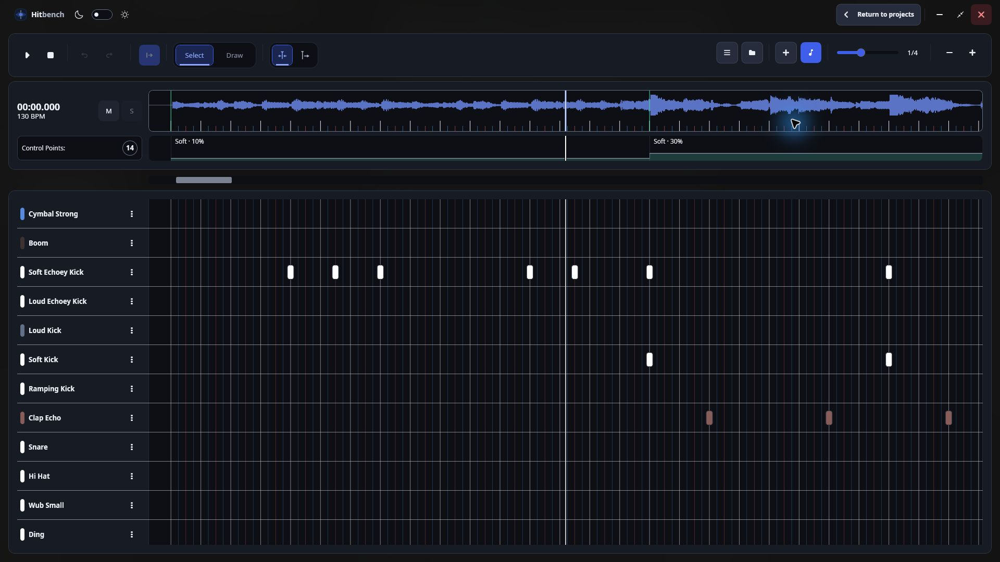

[Getting started](#getting-started) · [Features](#features) · [Keyboard shortcuts](#keyboard-shortcuts) · [Building from source](#building-from-source) · [Changelog](#changelog) · [Feedback](#feedback)

## Getting started

1. Download the Windows x64 ZIP from [Releases](https://github.com/Hokichi/osuHitsounder/releases).
2. Extract it into a writable folder and launch `Hitbench.exe`. Release packages include the .NET runtime.
3. Locate your osu! installation or mapsets folder.
4. Select a mapset, choose **Create a new project**, and enter a project name.
5. Add a **Sample Track** or **Instrumental Track** and start arranging.

Projects save automatically as you work. Project files live in the `projects` folder beside the application.

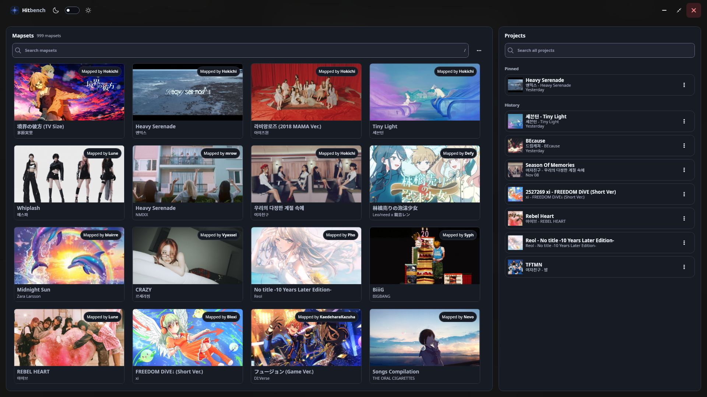

## Features

- [Timeline editing](#timeline-editing)
- [Tracks and organization](#tracks-and-organization)
- [Instrumental arrangement](#instrumental-arrangement)
- [Sample management](#sample-management)
- [Default hitsounds and hitnormal configuration](#default-hitsounds-and-hitnormal-configuration)
- [Control points and volume ramps](#control-points-and-volume-ramps)
- [Playback and navigation](#playback-and-navigation)
- [Beatmap export](#beatmap-export)
- [Projects and appearance](#projects-and-appearance)

### Timeline editing

- Switch between **Select** mode to select and move nodes and **Draw** mode to place them.
- Adjust beat subdivision to control snapping.
- Zoom in for precise placement or out to view longer sections.
- Use **Actions → Resnap** to align existing samples, control points, and instrumental notes to the current subdivision.
- Undo and redo edits using the toolbar or keyboard shortcuts.

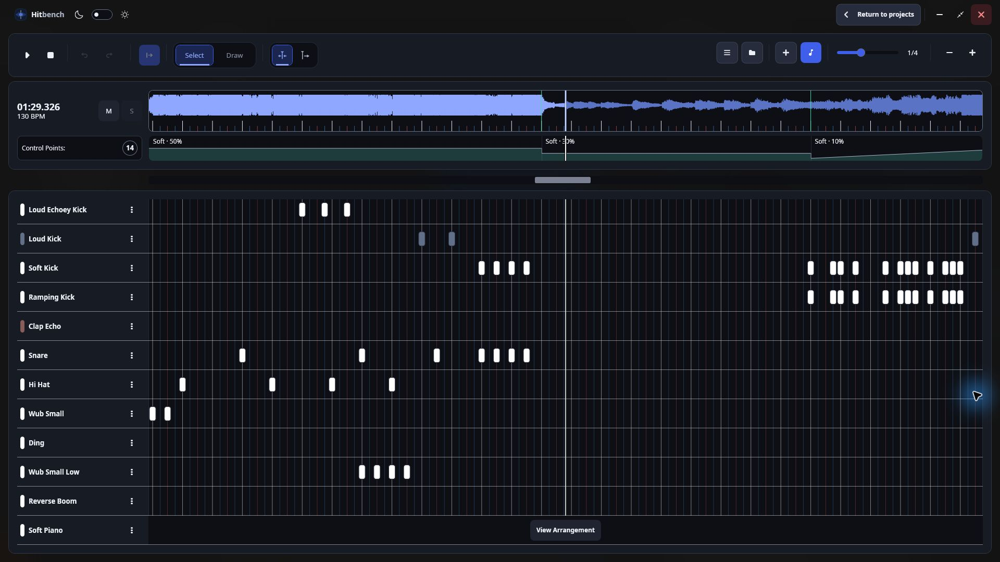

### Tracks and organization

- Add sample tracks for individual sounds or instrumental tracks for pitched parts.
- Rename, recolor, reorder, and collapse tracks to keep larger arrangements readable.
- Organize sample files into folders.
- Adjust track volume and use mute or solo controls to audition parts against the song.

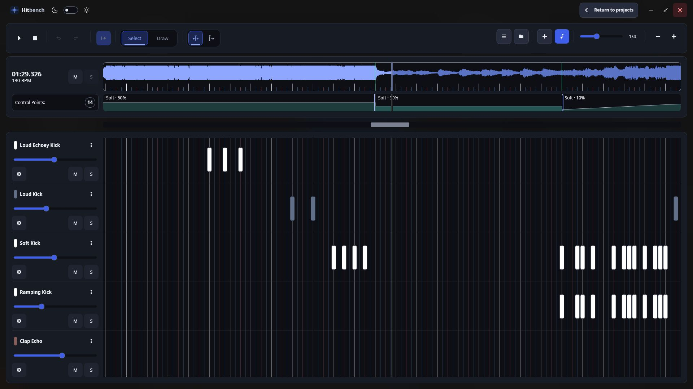

### Instrumental arrangement

- Map audio samples to musical keys from **C1 through B9** using **Keys Mapping**.
- Import a folder of note-named samples to populate key mappings.
- Place and move notes against the beat grid.
- Preview instrumental notes alongside sample tracks and the song.
- Use keyboard navigation to select keys, place notes, and adjust their positions.

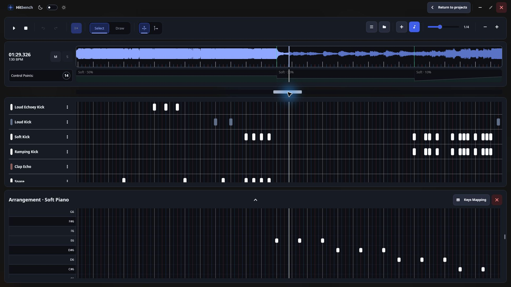

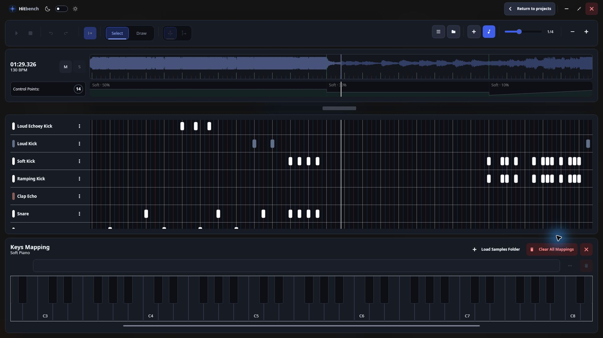

### Sample management

- Import **WAV**, **OGG**, and **MP3** files.
- Drag audio files into the workstation.
- Browse and preview sounds through the sample manager.
- Import samples from the source mapset, with duplicate handling when files already exist.
- Refresh project samples after editing or replacing audio files externally.
- Keep the sample manager and instrumental arrangement open together while working.

Mapset samples are imported automatically when you create a project.

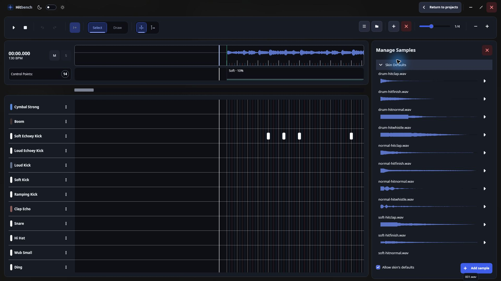

### Default hitsounds and hitnormal configuration

- Use default hitsound tracks with sample sources resolved from your configured skin.
- Browse project samples and skin samples in separate expandable groups.
- Configure project hitnormal samples through **Actions → Config Hitnormal**.
- Carry your default-sample and hitnormal choices into export.

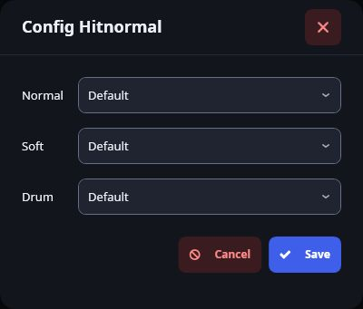

### Control points and volume ramps

- Add control points to change volume and sample set at specific positions.
- Move control points along the timeline.
- Create volume ramps for gradual transitions.
- Preview volume changes during playback, including their effect on sample tails.
- Export control-point and ramp behavior with the arrangement.

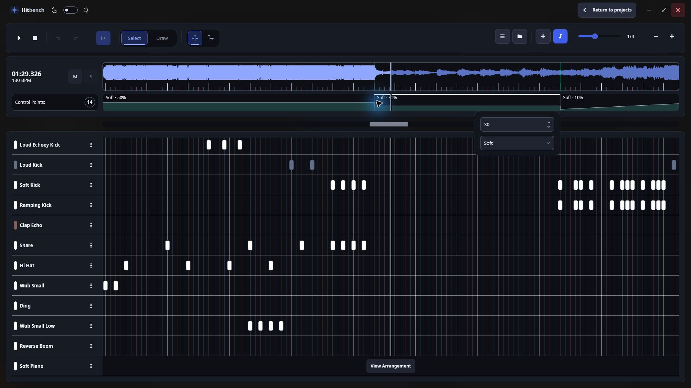

### Playback and navigation

- Play, pause, stop, and seek through the song.
- Follow the playback marker automatically.
- Switch between a moving marker and a centered marker with scrolling tracks.
- Navigate static-marker playback using wheel and drag gestures.
- Retain the project's marker mode when reopening it.

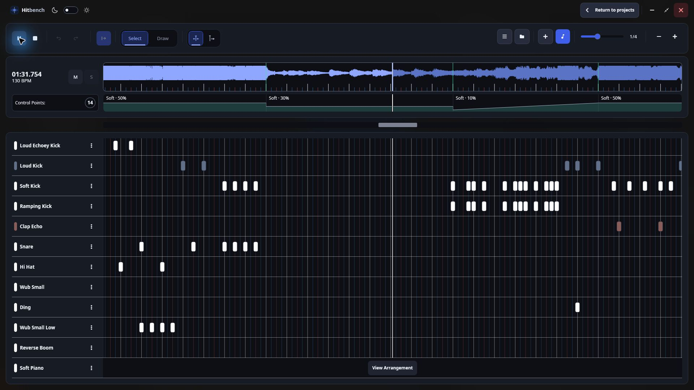

### Beatmap export

Open **Actions → Export** to configure:

- The exported difficulty name.
- The starting sample index.
- Separate formats for individual and mixed samples: **OGG**, **WAV**, or **MP3**.
- The output destination.
- Whether to open the output folder after export.

Choose **Project** to write output into the project's `Export` folder, or **Beatmap** to write into the source mapset folder.

The exporter combines overlapping sounds where needed and reuses samples to reduce generated assets. Export progress is shown while processing, and the operation can be canceled.

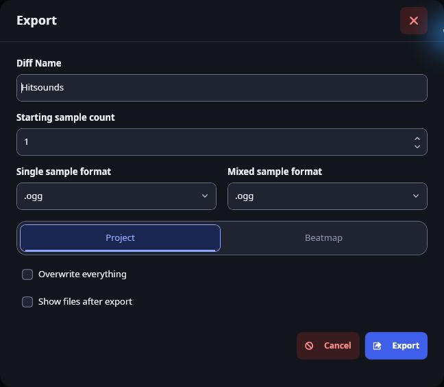

### Projects and appearance

- Browse and search mapsets and existing projects from the home screen.
- Keep separate hitsounding projects for the same mapset.
- Save arrangement changes automatically.
- Open project and beatmap folders directly from the workstation.
- Switch between light and dark themes.

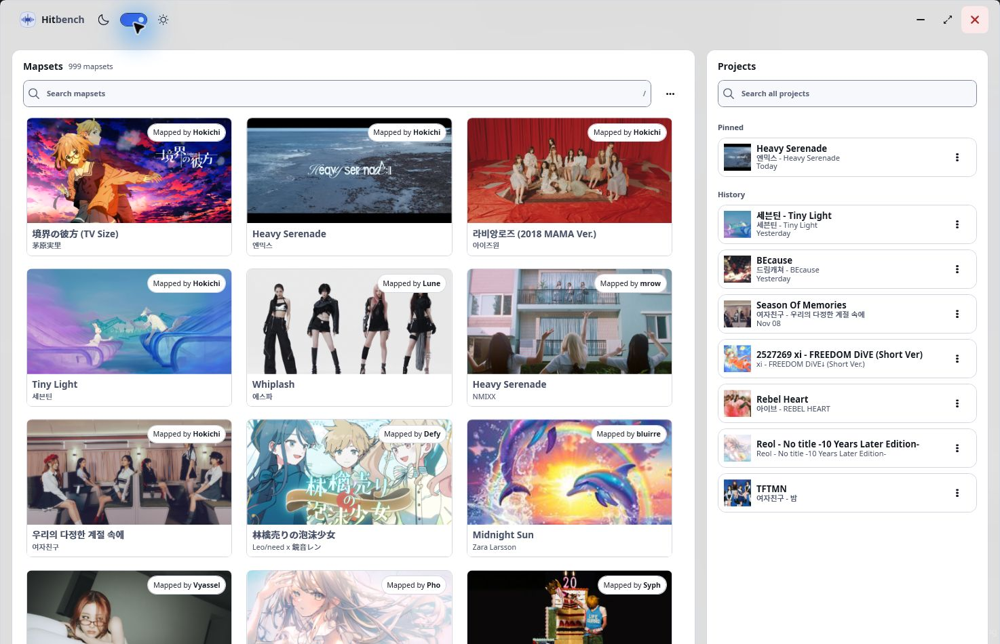

## Keyboard shortcuts

| Shortcut | Action |
|---|---|
| `Space` | Play or pause |
| `Shift+Space` | Stop |
| `1` / `2` | Select / Draw mode |
| `Ctrl+Z` / `Ctrl+Y` | Undo / Redo |
| `Ctrl+N` | Add sample track |
| `Ctrl+Shift+N` | Add instrumental track |
| `F2` | Manage samples |
| `F4` | Collapse or expand all tracks |
| `F5` | Refresh samples |
| `F6` | Add control point |
| `F` | Toggle following the playback marker |
| `F8` | Switch playback marker mode |

## Website

The static website lives in `docs`. Publish the `main` branch's `/docs` folder with GitHub Pages. Its screenshots live in `docs/images` and are shared with this README.

## Building from source

Requires Windows and the .NET 10 SDK.

```powershell
dotnet build Hitbench.slnx
dotnet run --project Hitbench/Hitbench.csproj
```

## Changelog

Selected changes from the project's Git history.

### 0.0.4-beta

- Added centered playback marker mode with scrolling timeline content.
- Added wheel and drag navigation for static-marker playback.
- Saved playback marker mode per project.
- Improved timeline rendering during playback.
- Added undo and redo buttons to the workstation toolbar.
- Added project hitnormal sample configuration.
- Improved export sample reuse optimization.

### 0.0.3-beta

- Added mapset sample imports and duplicate replacement controls.
- Added skin-backed default hitsound tracks.
- Grouped project and skin samples in the sample manager.
- Improved playback scrubbing with drag capture and edge scrolling.
- Improved handling of native default samples and mixed samples during export.
- Fixed the exported beatmap template.

### 0.0.2-beta

- Added editable volume ramps and connected control-point automation zones.
- Applied continuous volume changes to sample tails during playback.
- Improved export handling for volume envelopes and sample reuse.
- Added release channels and in-app updates.

## Feedback

Report bugs and suggest improvements through [GitHub Issues](https://github.com/Hokichi/osuHitsounder/issues).
